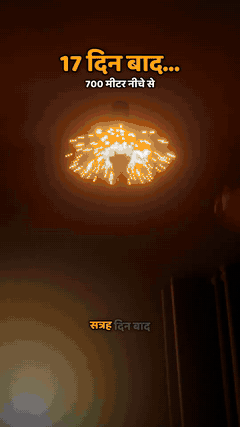

# 🎬 3d-animator: cinematic 3D story Shorts from code



▶ **Demo videos (MP4):** [showreel](../../../assets/demos/3d-animator.mp4) · [Chile 33 miners](../../../assets/demos/3d-animator-chile.mp4) · [Arunima Sinha](../../../assets/demos/3d-animator-arunima.mp4) · [Thai cave rescue](../../../assets/demos/3d-animator-thai.mp4)

True stories, made as cinematic 3D films (Dashrath Manjhi style). It uses three.js rendered frame by frame in headless Chrome, with
motion blur, depth of field, soft shadows, bloom, a film grade and word-synced Hindi captions.
**Real photos** appear in paper-cut style (torn edge, tape) **only at the true-fact moments.**

## Kaise prompt dein (format)
```
/3d-animator  <कहानी का नाम>, 3D cinematic, <लंबाई> sec vertical Short, Hindi
              Hook: <पहला सीन जो 1st frame पे दिखे>
              Real photos: <किन fact moments पे असली फोटो चाहिए>
              Voice: <MP3 attach करो या "script pehle do">
```
**Examples**
```
/3d-animator  Dashrath Manjhi ki kahani, 3D cinematic, 60 sec Short, Hindi. Hook: hathoda pahad pe girta hai.
/3d-animator  Chile ke 33 miners, 3D cinematic jaisa Manjhi, real photo sirf fact pe (parchi, capsule). Meri MP3 attach hai.
/3d-animator  Thai cave rescue, hook me paani badhta hua, captions chhote, loop ending
/3d-animator  Ek 20 second ka cinematic desk scene, golden hour, no voice
```
**Tips:** "hook energetic rakho", "subtitle chhote karo", "voice thoda fast (1.08x)", "ye scene dobara render karo".

## Aapko kya milta hai
`deliver/<name>.mp4` (1080×1920, 30 fps), `youtube.txt` (title, description with photo credits, tags, hashtags, pin comment), `thumbnail.jpg`.

## Andar kya hai
| Path | What |
|---|---|
| `SKILL.md` | the director's rules: camera, light, motion, sound |
| `kit/` | starter film, frame-exact `render.mjs`, sound mixer |
| `examples/vertical-short-template/` | **`cine.js`** toolkit (terrain, people, photoCard, captions, titles), `render_segs.sh` resumable render, `tools/` (Whisper word timing, SFX) |
| `examples/{hichki,manjhi,chile,arunima,thai}/film.js` | the real Shorts shown above |
| `references/`, `recipes/` | camera, light, motion, sound guides; 2 full recipes |
| `CHATGPT_GUIDE.md` | how to use this with ChatGPT or Codex (Hindi) |

**Needs:** Node 20+, ffmpeg, Python 3 (`pip install faster-whisper scipy numpy`). No GPU needed (SwiftShader); about 2 hours for a 60 s Short on 4 CPU cores.

**Demo photo credits (Wikimedia Commons):** "Estamos bien los 33" (José Ojeda, PD) · "Mina San José de Copiapó en 2010" (desierto_atacama, CC BY-SA 2.0) · "Fénix-2 en exhibición en Santiago" (Diode, PD) · "Florencio Avalos" and "Los 33 at Moneda Ceremony" (Gobierno de Chile, CC BY 2.0) · "Arunima sinha.png" (CC BY-SA 3.0) · Padma Shri ceremony 2015 (President's Secretariat, GODL-India) · "Tham Luang 2018 Cave Rescue Map" (BekRad, CC BY-SA 4.0) · Tham Luang rescue divers (U.S. Air Force, PD) · "Tham Luang cave rescue countries" (Wadesola, CC BY-SA 4.0) · NBT photos of Tham Luang (CC BY 3.0). 3D scenes are artistic reconstructions.
