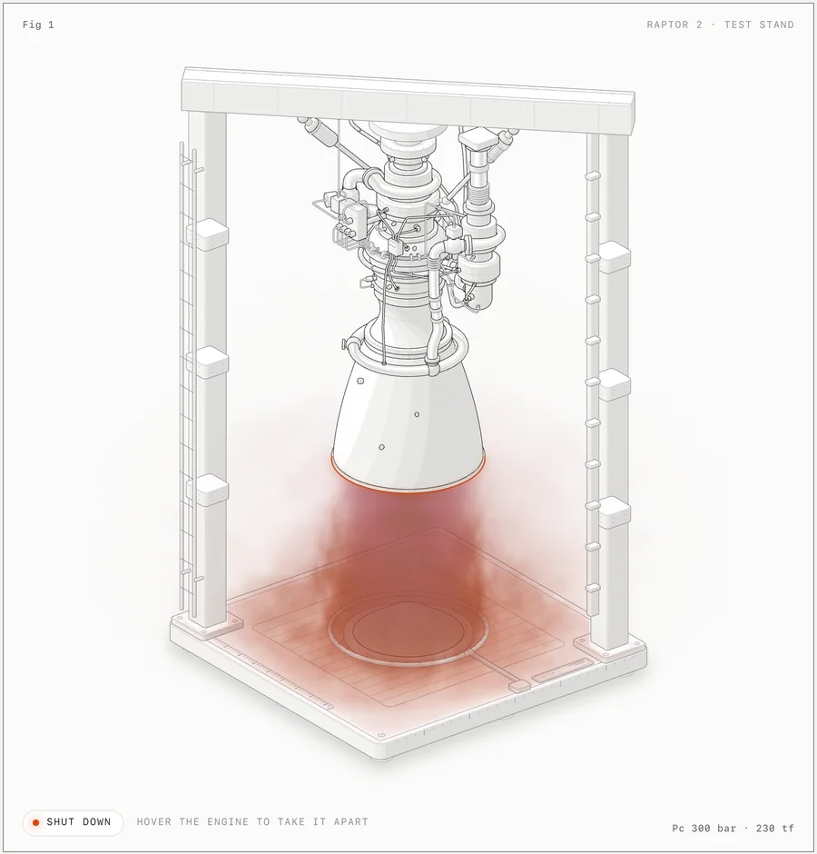
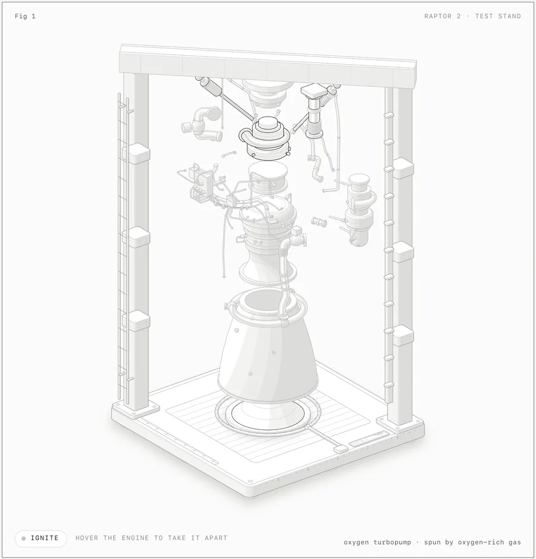
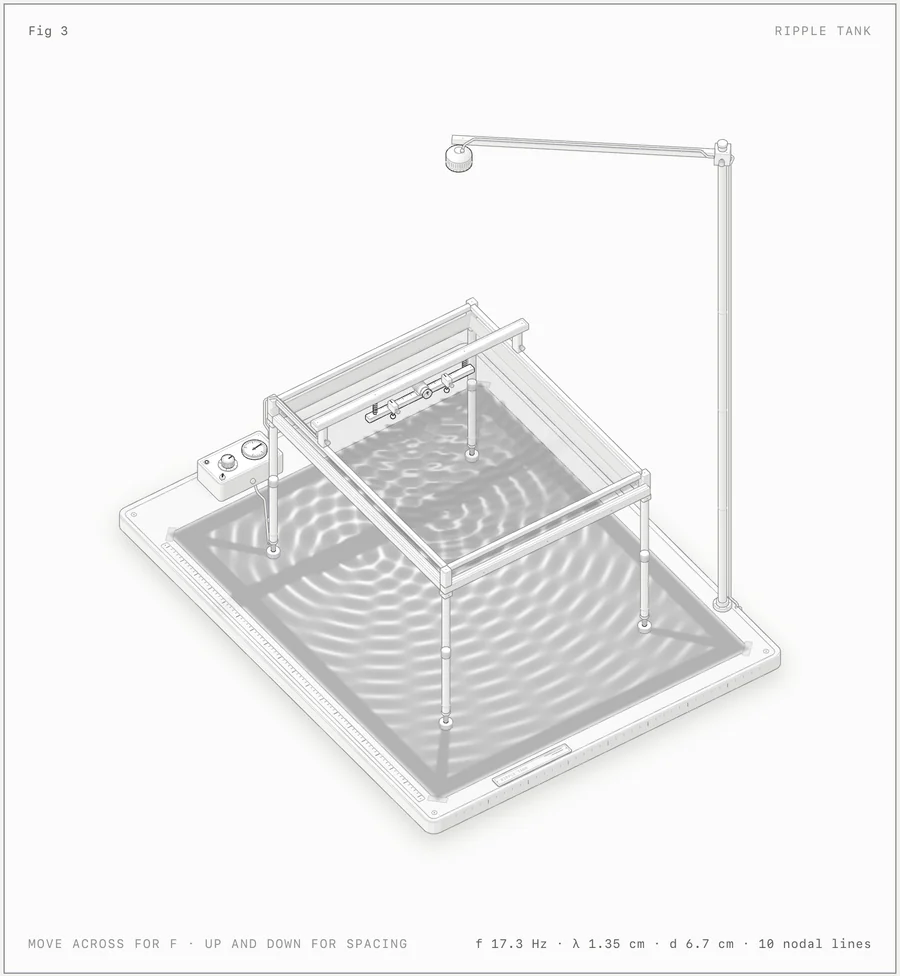

# 🔩 anatomy: isometric "real object" explainers *(by Ryan, MIT)*

| | | |
|---|---|---|
|  |  |  |

Explains an idea by drawing it as a precise little machine (interactive SVG + WebGL, A4 PDF export).

## Kaise prompt dein (format)
```
/anatomy  <किस चीज़/idea को समझाना है>, <interactive / PDF / reel clip>
```
**Examples:** `/anatomy explain how a rocket engine works, interactive` · `/anatomy how a token bucket rate limiter works`
**Reel ke liye:** phir `/frame-capture` se 60 fps clip record karo. **Needs:** Node 20.10+, Chrome.
