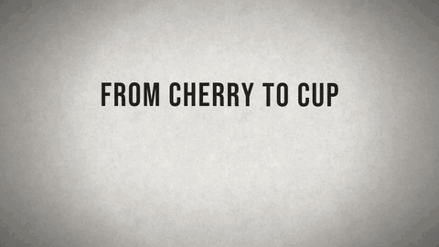
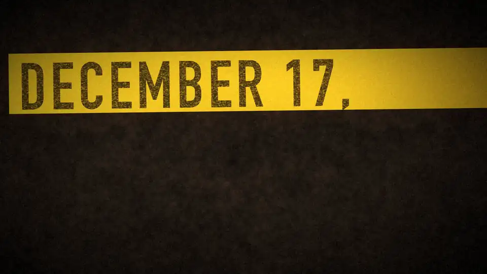

# 🗂️ cinematic-film: evidence-wall documentary *(by exploraX, MIT)*





One continuous camera glides over a wall of photos, newspaper clippings, documents, maps with routes, stamps and counters,
and each one lands on the narrator's word. Photos come from Wikimedia Commons, with their licences recorded.

## Kaise prompt dein (format)
```
/cinematic-film  <विषय>, <लंबाई>, <look: evidence wall / studio / blueprint / night>, <Hindi/English>, <voice: MP3 ya free voice>
```
**Examples**
```
/cinematic-film  90 second documentary about the Wright brothers' first flight
/cinematic-film  Bhagat Singh ki kahani, evidence-wall style, Hindi, meri ElevenLabs MP3 se
/cinematic-film  Launch film for my product, studio look
```
## Aapko kya milta hai
MP4 (16:9 or 9:16), 4 caption styles, SRT, `credits.md`. **Needs:** `pip install skia-python numpy pillow scipy`, ffmpeg.
