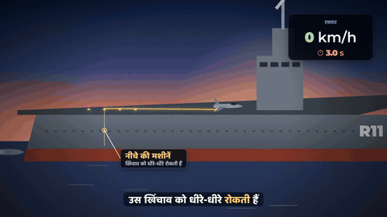
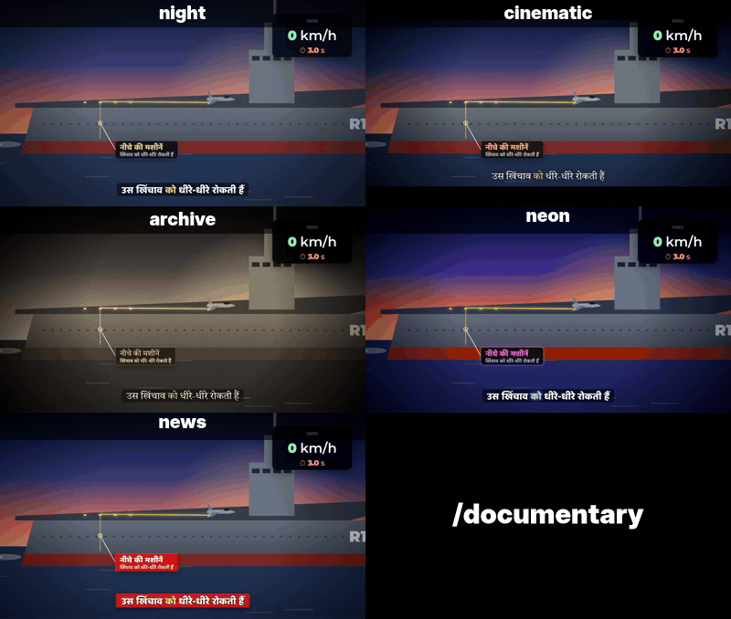

# 🎥 documentary: premium YouTube documentary (2D or 3D realistic)



▶ **Demo videos (MP4):** [INS Vikrant (2D, 16:9)](../../../assets/demos/documentary-2d.mp4) · [Chandrayaan-3 landing (vertical Short)](../../../assets/demos/documentary-3d-short.mp4)




3–6 minute films (1920×1080, 60 fps) with animated diagrams, labels, counters, chapter cards, word-synced captions and a soundtrack.
2D themes: `night` · `cinematic` · `archive` · `neon` · `news`. 3D realistic mode: sky, ocean, sun shadows, film grade, in 16:9 or 9:16.

## Kaise prompt dein (format)
```
/documentary  <विषय>, <लंबाई>, <Hindi/English>, <theme ya "3D realistic">, <16:9 ya vertical>
```
**Examples**
```
/documentary  INS Vikrant ki kahani, 5 minute, Hindi
/documentary  1857 ki kranti, archive theme
/documentary  Chandrayaan-3 landing, 3D realistic, vertical 50 sec Short (VIEW=1080x1920)
/documentary  English version bhi banao
```
## Aapko kya milta hai
`film.mp4`, `.srt` subtitles, 3 thumbnails, `youtube.txt` (titles, description, chapters, tags, hashtags).
