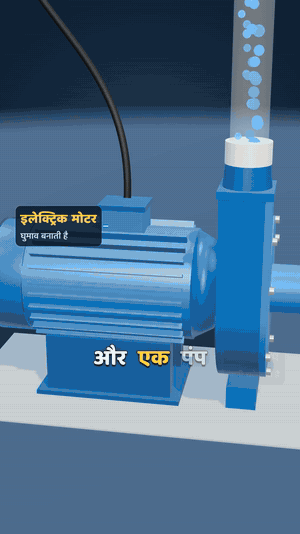
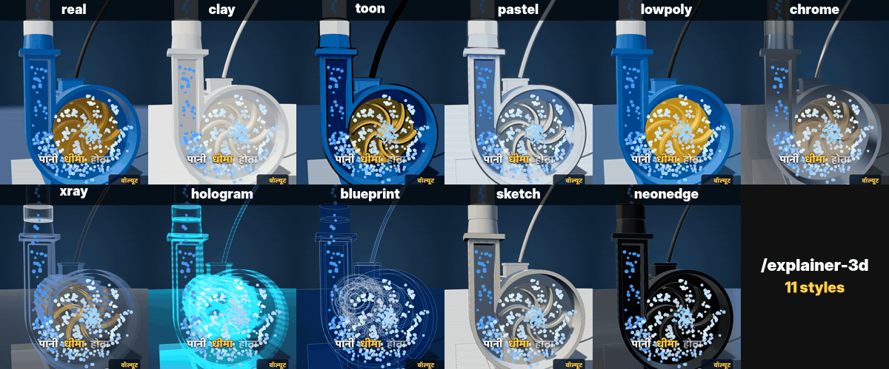
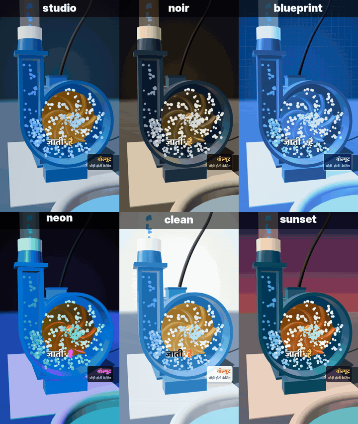

# ⚙️ explainer-3d: 3D "how it works" Short



▶ **Demo video (MP4):** [Pressure cooker Short](../../../assets/demos/explainer-3d.mp4)

The machine is built from code in three.js: x-ray shells, cutaways, exploded views, flow particles, labels with leader lines,
word-synced captions, music and SFX. **11 styles × 6 themes = 66 looks.**




## Kaise prompt dein (format)
```
/explainer-3d  <मशीन> kaise kaam karta hai, <Hindi/English> Short, <style> style, <theme> theme
```
- **Styles:** real · clay · toon · pastel · lowpoly · chrome · xray · hologram · blueprint · sketch · neonedge
- **Themes:** studio · noir · blueprint · neon · clean · sunset

**Examples**
```
/explainer-3d  Mixer grinder kaise kaam karta hai, Hindi Short
/explainer-3d  How an AC cools a room, English, clay style, clean theme
/explainer-3d  Bike ka carburetor, hologram style, neon theme
```
## Aapko kya milta hai
`short.mp4` (1080×1920, 60 fps, about 55 s), Shorts title, description, tags and thumbnail ideas. **Needs:** Node, Python, ffmpeg (offline).
