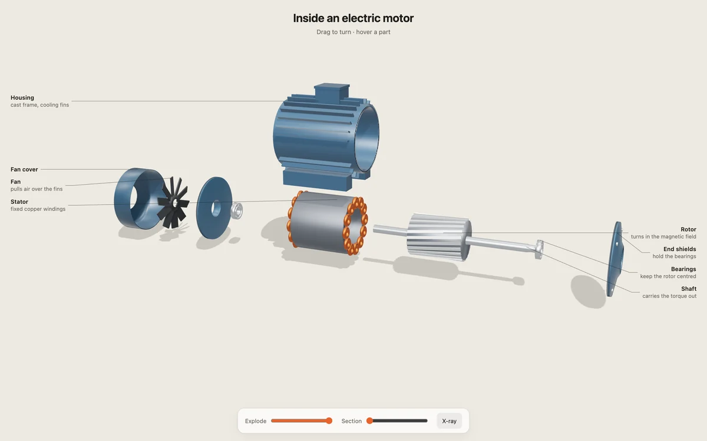

# 💥 exploded-view: open a machine in stages *(Open 3D Skills by exploraX, MIT)*



Staged exploded view, x-ray shells, a section cut and labels with leader lines that never cover the model.

## Kaise prompt dein (format)
```
/exploded-view  <मशीन> ko khol ke dikhao, <slider / scroll / video>
```
**Examples**
```
/exploded-view  show how a ceiling fan motor works
/exploded-view  bike engine ke parts alag karke dikhao, labels Hindi me
```

