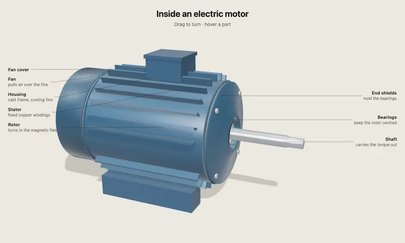

# 🎞️ frame-capture: smooth 60 fps video of any web animation *(Open 3D Skills by exploraX, MIT)*



Runs the page on a virtual clock, one exact frame at a time, so the MP4 never stutters. Also makes A-vs-B comparison videos.

## Kaise prompt dein (format)
```
/frame-capture  <page/file> ko record karo, <length> sec, <16:9 ya vertical>
```
**Examples**
```
/frame-capture  record this page as a 30 second vertical video
/frame-capture  old vs new version side-by-side comparison
```

