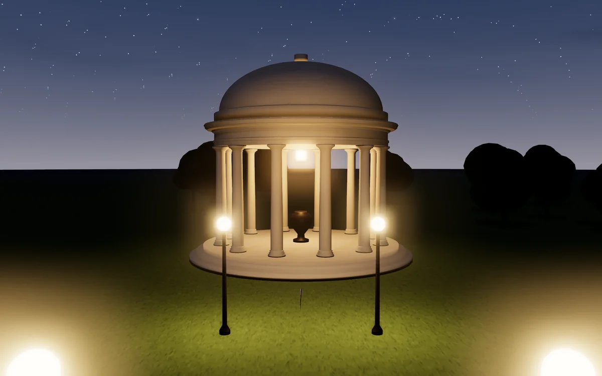

# ✅ site-check: test a 3D page on phone, tablet and desktop *(Open 3D Skills by exploraX, MIT)*



Shoots every view in Chromium and WebKit (Safari), measures frame time, catches blank WebGL canvases and errors, and builds one contact sheet.

## Kaise prompt dein (format)
```
/site-check  <page> ko <mobile/Safari/desktop> pe check karo
```
**Examples**
```
/site-check  check my 3D page on mobile
/site-check  why is it slow in Safari
```

