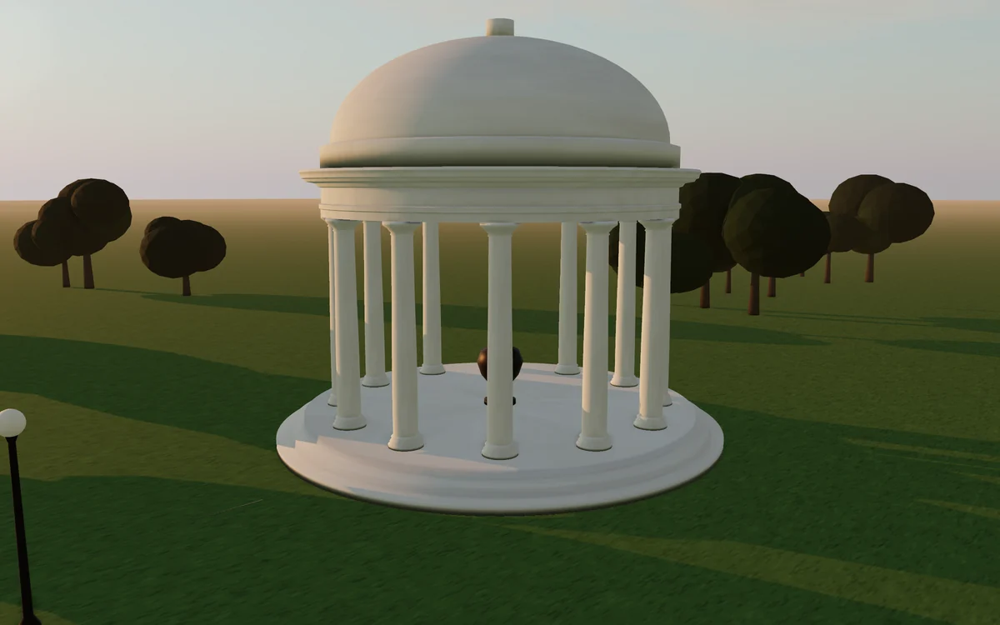

# 🏗️ threejs-scene: real-time 3D from code *(Open 3D Skills by exploraX, MIT)*



Buildings, vehicles, machines and landscapes from procedural geometry, with a physical sky and sun, soft shadows, AO and bloom.

## Kaise prompt dein (format)
```
/threejs-scene  <क्या बनाना है>, <time of day / mood>, <website hero ya video ke liye>
```
**Examples**
```
/threejs-scene  a 3D model of the Chenab bridge at golden hour
/threejs-scene  INS Vikrant on the ocean at sunset, cinematic
```
**Video chahiye?** Scene banne ke baad `/frame-capture` se record karo.
