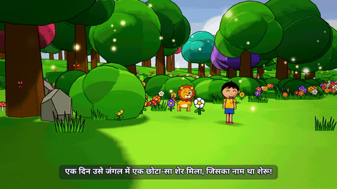

# Claude Animated Shorts: 3 video skills for Claude Code

Three skills that turn Claude Code into a YouTube animation studio for Hindi and English videos.
Everything is drawn with code and rendered on your own computer. There's no AI video generator,
no stock footage and no paid service. Bring a voice MP3 (ElevenLabs or any other) and you get a finished video.

| Skill | Type this in Claude Code | You get |
|---|---|---|
| **3D machine explainer** | `/explainer-3d` | 50-60 s vertical Short (1080×1920, 60 fps): a machine built in 3D, opened up, explained part by part |
| **2D documentary** | `/documentary` | 3-6 min YouTube documentary (1920×1080, 60 fps) with chapters, diagrams, counters, captions and thumbnails |
| **Cartoon story short** | `/cartoon-3d-short` | 55-90 s cartoon story: 2D characters in a painted 3D world, ink outlines, gliding camera |
| **3D documentary case file** | `/case-file` | Prompts only: a full blueprint (timeline, scene table, image prompts, 30 s video prompts with sound, narration, edit checklist) for any AI image/video/voice tool |

---

## 1. `/explainer-3d`: 3D "how it works" Short (motor-video style)


*Water motor, bike engine and submersible pump, all made with this skill.*

**How to use**
```
/explainer-3d  How does a mixer grinder work? Hindi Short
```
1. Claude writes the facts and the script, line by line with the picture for each line, and gives you the Hindi script with ElevenLabs tags.
2. You send the MP3, or ask for the free offline English voice.
3. Claude builds the machine in 3D from code, times every move to the voice, checks stills, then renders.

**What you get:** `short.mp4` (1080×1920, 60 fps, about 55 s, word-by-word captions, music and sound effects),
a Shorts title, description, tags, and thumbnail ideas.

---

## 2. `/documentary`: 2D premium documentary


*INS Vikrant, Chenab Bridge, Rail ka Jadu and Chandrayaan-3, all made with this skill.*

**How to use**
```
/documentary  INS Vikrant
```
1. Claude picks the angle, researches the facts and writes a 4-5 minute chapter script with ElevenLabs v3 emotion tags.
2. You make the MP3 in ElevenLabs (Eleven v3) and send it.
3. Claude times every word, animates every chapter, adds the soundtrack and renders.
4. Want English too? Say "English version bhi banao": same animation, English text and captions, separate video.

**What you get:** `film.mp4` (1920×1080, 60 fps, about 200 MB for 5 minutes), `.srt` subtitles, 3 thumbnails, and
`youtube.txt` with titles, description, chapters, tags and hashtags.

---

## 3. `/cartoon-3d-short`: cartoon story short



*From "जादुई जंगल का रहस्य", a Hindi cartoon short made with this skill.*

**How to use**
```
/cartoon-3d-short  A short story about a clever crow and a thirsty fox, in Hindi
```
Claude writes the story and the script, designs the characters and the world, plans every camera shot, renders in
chunks and mixes the voice, music and sound effects.

**What you get:** the finished short (vertical or 16:9), the script, and the subtitle timings.
It needs [Remotion](https://www.remotion.dev/) (installed with `npm install` in the project).

---

## 4. `/case-file`: photorealistic 3D/VFX documentary blueprint (prompts only)

**How to use**
```
/case-file  Make me a documentary about the origin of Spider-Man. Treat it as a real incident.
```
Run `/case-file` with no idea to see the 5-phase process first. Unlike the other skills it renders nothing:
it gives you a deadpan forensic "case file" of prompts written at feature-film VFX quality (anamorphic lens
specs, PBR materials, ACEScg lighting, Houdini-style simulation cues), and you paste them into the tools you use.

| Phase | Deliverable | Purpose |
|---|---|---|
| 1. Case Brief | Incident timeline & tone sheet | Locks timestamps, locations (`LOC-XX`), subjects (`CHAR-XX`), evidence (`PROP-XX`) |
| 2. Asset Bible | Reference prompt plates (16:9) | Photorealistic character, location and macro prop sheets for consistency |
| 3. Sequence Blueprints | Continuous 30 s single-scene prompts | 4-beat choreography with camera rigs, VFX sims and foley |
| 4. Keyframe Chain | Start/end still prompts (16:9) | Beat-by-beat keyframes for image-to-video models (Veo, Runway, Kling) |
| 5. Narration & Audio | Deadpan voiceover + foley cue sheet | Timecoded narration synced to room tone, micro-foley and sub-bass score |

---

## Install (once)

```bash
git clone https://github.com/VCbro/claude-animated-shorts.git
mkdir -p ~/.claude/skills
cp -r claude-animated-shorts/.claude/skills/* ~/.claude/skills/
```
Then restart Claude Code and type `/explainer-3d`, `/documentary`, `/cartoon-3d-short` or `/case-file`.

**You also need:** Node.js 18+, Python 3.10+ and ffmpeg. Each skill tells Claude the exact `npm install` and
`pip install` commands, and Claude runs them in your new project the first time.
A GPU isn't needed. Videos render with software WebGL; a 5-minute documentary takes about 30-60 minutes on 4 CPU cores.

## What's inside

```
.claude/skills/
  explainer-3d/        SKILL.md, template/ (the full water-motor project), examples/ (bike engine, submersible pump),
                       reference/ (three.js geometry, lighting, shaders, exploded views, frame capture)
  documentary/         SKILL.md, template/ (2D engine, Whisper timing, alignment, capture, soundtrack, thumbnails),
                       examples/ (the complete INS Vikrant film: script, anchors, film.js, audio)
  cartoon-3d-short/    SKILL.md, templates/ (bridge short source, audio, QA scripts), references/ (style research),
                       examples/jadui-jungle-hindi/ (a complete Hindi cartoon project)
  case-file/           SKILL.md, references/cinematic-3d-vfx.md (lens, PBR, lighting, VFX and negative-prompt spec)
assets/                demo GIFs
```

## Tips
- **Voice:** ElevenLabs **Eleven v3** with a deep narrator voice works best. Emotion tags in `[ ]` aren't spoken.
- **Hindi + English:** upload as two separate videos and set "Video language" for each. YouTube's multi-language
  audio feature isn't available on most channels.
- **File size:** 1080p 60 fps keeps a 5-minute film around 200 MB, small enough to send in chat. 4K files are over 500 MB.

## License
MIT (see `LICENSE`). The reference frames in `cartoon-3d-short/references/` are for style study only.
