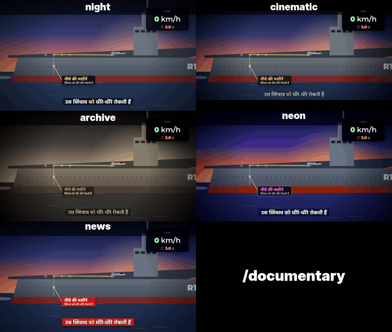
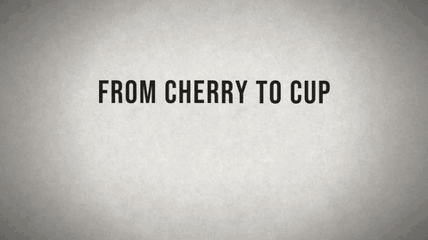
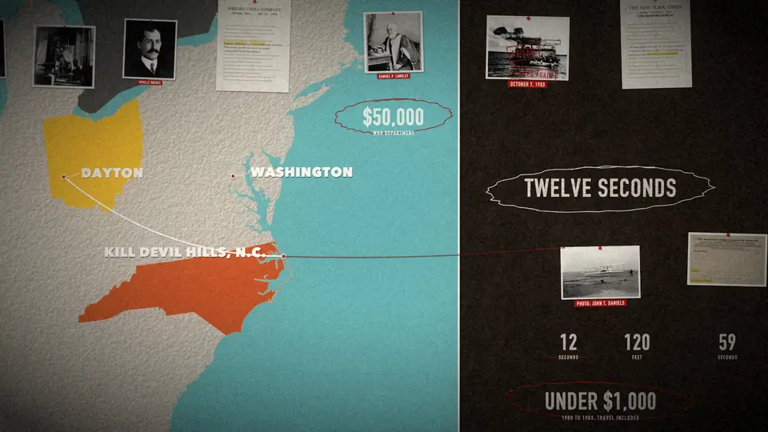
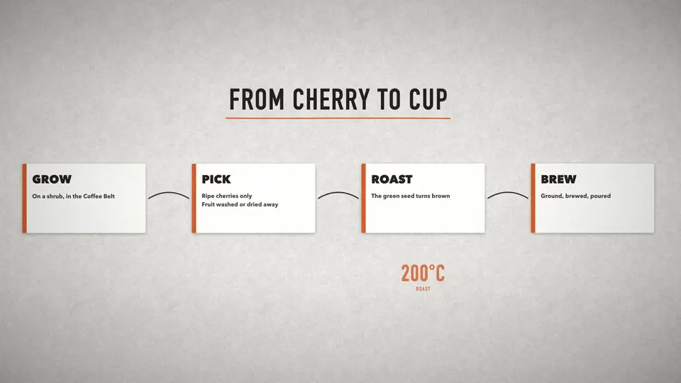
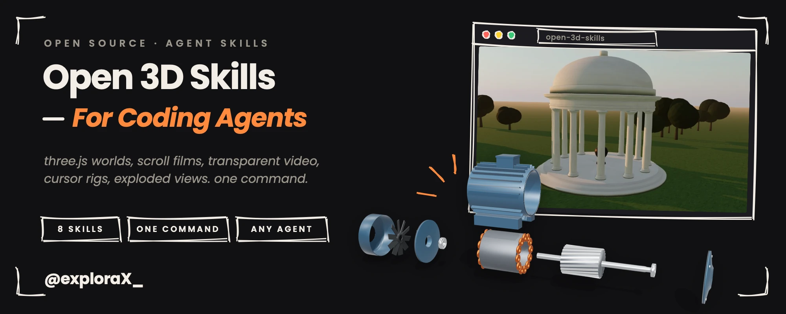
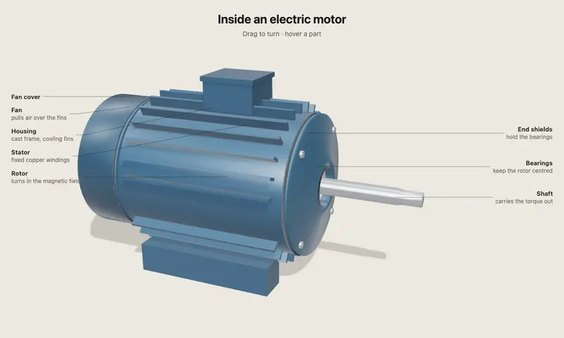

# Claude Animated Shorts: a video and 3D skill pack for Claude Code

Skills that turn Claude Code into a YouTube and Instagram animation studio, for Hindi and English.
Everything is drawn with code and rendered on your own computer. **100% free:** no paid AI generator, no API credits, no stock footage.
Bring a voice MP3 (ElevenLabs or any other) and you get a finished video.

## 🇮🇳 Shuru kaise karein (Hinglish quick guide)
1. **Install (ek baar):** neeche "Install" wale 3 commands chalao, phir Claude Code restart karo.
2. **Skill chalao:** Claude Code mein `/` ke baad skill ka naam likho, phir aapko kya chahiye. Jaise:
   `/explainer-3d Mixer grinder kaise kaam karta hai, toon style, sunset theme, Hindi Short`
3. **Script lo:** Claude script deta hai (ElevenLabs v3 tags `[ ]` ke saath). ElevenLabs mein Eleven v3 model se MP3 banao aur Claude ko bhejo.
4. **Video lo:** Claude timing set karke stills dikhata hai, phir render karke MP4, thumbnails aur title/description/tags deta hai.
5. **Look badalna ho:** bas likho "noir theme try karo" ya "clay style mein dikhao". Claude 3-4 stills bana ke dikhayega, aap chuno.

| Mujhe chahiye… | Skill |
|---|---|
| Sachchi kahani ka cinematic 3D Short (Manjhi, Chile miners…) | `/3d-animator` |
| Machine ka 3D Short (motor, engine, AC…) | `/explainer-3d` |
| 4-5 min ki documentary (2D ya 3D realistic) | `/documentary` |
| Photo, map aur newspaper wali "evidence wall" documentary | `/cinematic-film` |
| 3D realistic Short (jahaz, rocket, pul, car) | `/documentary` 3D mode, vertical mein (neeche dekho) |
| Kisi idea ka sundar isometric diagram (blog, thumbnail, reel) | `/anatomy` |
| Machine ko khol ke dikhana (exploded view) | `/exploded-view` |
| Kisi bhi web animation ko smooth 60fps video banana | `/frame-capture` |
| 3D page ko mobile/Safari pe check karna | `/site-check` |

## 📚 All skills (har skill ka alag README, prompt format aur demo)

| Skill | Kya banata hai | Demo | README |
|---|---|---|---|
| `/3d-animator` 🆕 | Cinematic 3D true-story Shorts + real photos in paper-cut style | [▶ MP4](assets/demos/3d-animator.mp4) | [README](.claude/skills/3d-animator/README.md) |
| `/explainer-3d` | 3D "how it works" machine Shorts, 66 looks | [▶ MP4](assets/demos/explainer-3d.mp4) | [README](.claude/skills/explainer-3d/README.md) |
| `/documentary` | 3–6 min documentaries, 2D or 3D realistic | [▶ 2D](assets/demos/documentary-2d.mp4) · [▶ Short](assets/demos/documentary-3d-short.mp4) | [README](.claude/skills/documentary/README.md) |
| `/cinematic-film` | Evidence-wall documentary from photos and documents | [GIF](assets/cinematic-film.gif) | [README](.claude/skills/cinematic-film/README.md) |
| `/anatomy` | Isometric object explainers | [image](assets/upstream/anatomy-raptor-engine-firing.webp) | [README](.claude/skills/anatomy/README.md) |
| `/threejs-scene` | Real-time 3D scenes from code | [image](assets/upstream/pavilion-golden.webp) | [README](.claude/skills/threejs-scene/README.md) |
| `/exploded-view` | Machine exploded views | [image](assets/upstream/motor-exploded.webp) | [README](.claude/skills/exploded-view/README.md) |
| `/frame-capture` | Smooth 60 fps recording of any web animation | [image](assets/upstream/motor-take-apart.webp) | [README](.claude/skills/frame-capture/README.md) |
| `/site-check` | Test 3D pages on phone/Safari | [image](assets/upstream/pavilion-night.webp) | [README](.claude/skills/site-check/README.md) |

---

# 🎬 Video skills

## 0. `/3d-animator` 🆕: cinematic 3D true-story Shorts (Dashrath Manjhi style)


▶ **Demo videos:** [showreel](assets/demos/3d-animator.mp4) · [Chile 33 miners](assets/demos/3d-animator-chile.mp4) · [Arunima Sinha](assets/demos/3d-animator-arunima.mp4) · [Thai cave rescue](assets/demos/3d-animator-thai.mp4)

Real 3D films from code: three.js rendered frame by frame with motion blur, depth of field, soft shadows, bloom and a film grade.
People, terrain, caves, trains and rescue rigs are built procedurally; **real photos appear in paper-cut style only at the true-fact moments**.
The voice sets the clock: Whisper word timings drive the captions, titles and every sound effect.

**Prompt format**
```
/3d-animator  <kahani>, 3D cinematic, <60> sec vertical Short, Hindi
              Hook: <first frame ka action>   Real photos: <kin facts pe>   Voice: <MP3 attach>
```
```
/3d-animator  Chile ke 33 miners, 3D cinematic jaisa Manjhi, real photo sirf fact pe. Meri MP3 attach hai.
/3d-animator  Arunima Sinha, hook: Everest summit pe tiranga, captions chhote, loop ending
```
**You get:** MP4 (1080×1920), `youtube.txt` (title, description with photo credits, tags, pin comment), thumbnail.
ChatGPT/Codex ke saath use karna ho to: [CHATGPT_GUIDE.md](.claude/skills/3d-animator/CHATGPT_GUIDE.md).

---

## 1. `/explainer-3d`: 3D "how it works" Short (motor-video style)


*Water motor, bike engine and submersible pump, all made with this skill.*

### 11 styles: how the 3D is drawn


| Style | Look | Use for |
|---|---|---|
| `real` | physically based metal and plastic (default) | realistic explainers |
| `clay` | matte clay model | premium, Apple-keynote feel |
| `toon` | cel shading + black ink outlines | cartoon, fun facts |
| `pastel` | soft pastel toon | kids, friendly education |
| `lowpoly` | flat-shaded facets | game-like, stylised |
| `chrome` | polished metal everywhere | luxury, sci-fi |
| `xray` | see-through glowing shells | inside views, scan feel |
| `hologram` | cyan hologram + scanlines | future tech, sci-fi HUD |
| `blueprint` | white technical lines on blue | engineering drawing |
| `sketch` | paper model + pencil edges | whiteboard, hand-drawn |
| `neonedge` | dark parts with glowing edges | cyberpunk, gaming |

### 6 themes: colours, backdrop, light and captions


`studio` · `noir` · `blueprint` · `neon` · `clean` · `sunset`. **11 styles × 6 themes = 66 looks** for the same machine.
Good pairs: `clay`+`clean`, `toon`+`sunset`, `chrome`+`noir`, `hologram`+`neon`, `sketch`+`clean`.

**Prompts**
```
/explainer-3d  Mixer grinder kaise kaam karta hai, Hindi Short
/explainer-3d  How an AC cools a room, English, clay style, clean theme
/explainer-3d  Bike ka carburetor, hologram style, neon theme
```
**You get:** `short.mp4` (1080×1920, 60 fps, about 55 s, word-by-word captions, music and sound effects), a Shorts title,
description, tags and thumbnail ideas. It needs Node and Python, and runs offline.

---

## 2. `/documentary`: premium documentary (2D, or 3D realistic)


*INS Vikrant, Chenab Bridge, Rail ka Jadu and Chandrayaan-3, all made with this skill (2D mode).*

### 3D realistic mode


A physical sky and sun, a reflective ocean, shadows, bloom and a cinematic grade (letterbox, grain, warm/teal).
The subject is built from code with real proportions. It works in **16:9** (YouTube) and **9:16** (Shorts, with `VIEW=1080x1920`).

### 5 themes for 2D mode


`night` (defence, engineering) · `cinematic` (story-led) · `archive` (history, sepia film) · `neon` (tech, AI) · `news` (breaking explainers).

**Prompts**
```
/documentary  INS Vikrant ki kahani, 5 minute, Hindi
/documentary  1857 ki kranti, archive theme
/documentary  Chandrayaan-3 landing, 3D realistic
/documentary  English version bhi banao        (after the Hindi one: same animation, English captions and text)
```
**You get:** `film.mp4` (1920×1080, 60 fps, about 200 MB for 5 minutes), `.srt` subtitles, 3 thumbnails, and `youtube.txt`
(titles, description, chapters, tags, hashtags).

### 🔥 How to make a 3D realistic Short
```
/documentary  Make a 50 second vertical 3D realistic Short: INS Vikrant at sunset, a jet launching off the ski-jump.
              Use template-3d in vertical mode (VIEW=1080x1920), Hindi captions.
```
That's the best combination in this pack for "looks real": the 3D engine (sky, ocean, sun shadows, film grade) in
9:16, with `/threejs-scene` rules for the model and lighting and `/frame-capture` for a perfectly smooth 60 fps render.
For indoor machine close-ups use `/explainer-3d` with the `real` style and the `noir` or `studio` theme.

---

## 3. `/cinematic-film`: evidence-wall documentary *(by exploraX, MIT)*



*Above: the skill's starter film rendered here with a free offline voice. Below: its documentary example (from the original repo).*


| | |
|---|---|
|  |  |

One continuous camera glides over one designed world of photos, newspaper clippings, typeset documents, maps with routes,
stamps, highlighter swipes and rolling counters, and each one lands on the narrator's word. It finds public-domain photos on
Wikimedia Commons and records their licences. Looks: cork evidence wall, studio, blueprint/paper, night.

**Prompts**
```
/cinematic-film  90 second documentary about the Wright brothers' first flight
/cinematic-film  Bhagat Singh ki kahani, evidence-wall style, Hindi, meri ElevenLabs MP3 se
/cinematic-film  Launch film for my product, studio look
```
**You get:** an MP4 (16:9 or 9:16), 4 caption styles, an SRT, and `credits.md` for the photos.

**Try it yourself (free, about 2 minutes):**
```bash
cd ~/.claude/skills/cinematic-film/scripts
pip install skia-python numpy pillow scipy && python3 check_setup.py
python3 new_project.py ~/coffee && python3 get_fonts.py --project ~/coffee && python3 prep_assets.py --project ~/coffee
python3 tts_say.py --project ~/coffee          # free espeak-ng voice (or --cmd with extra/kokoro_tts.py)
python3 split_takes.py --project ~/coffee && python3 build_narration.py --project ~/coffee
python3 render.py --project ~/coffee --cues && python3 build_sfx.py --project ~/coffee && python3 mix_soundtrack.py --project ~/coffee
python3 render.py --project ~/coffee --size 1920x1080 --out out/film.mp4 --audio audio/mix.m4a
```
**Needs:** `pip install skia-python numpy pillow scipy`, plus ffmpeg. **Tested in this repo:** the starter film was built end to end with a free offline voice (Kokoro or `espeak-ng`). `scripts/check_setup.py` checks everything first, and `scripts/get_fonts.py` fetches free fonts.

**vs `/documentary`:** use `/cinematic-film` for history and true crime built from real photos and documents.
Use `/documentary` for machines, missions and engineering, where the drawing itself explains.

---

# 🧩 3D and helper skills

## 4. `/anatomy`: isometric "real object" explainers *(by Ryan, MIT)*

| | | |
|---|---|---|
|  |  |  |

It explains an idea by drawing it as a precise little machine: a rocket engine on a test stand, a ripple tank, a dial
gauge or an arcade cabinet, with hundreds of small parts, correct shading and calm motion. It's interactive (SVG + WebGL)
and can be exported as an A4 PDF.
**Prompts:** `/anatomy explain how a rocket engine works, interactive` · `/anatomy how a token bucket rate limiter works`
**For Shorts:** record the figure with `/frame-capture` → a crisp animated clip for B-roll or thumbnails.
**Needs:** Node 20.10+ and Chrome. No npm packages.

## 5-8. Open 3D Skills *(by exploraX, MIT)*: the free toolkit the motor videos were built on



| | |
|---|---|
|  |  |

| Skill | What it does | Example prompt |
|---|---|---|
| `/threejs-scene` | Real-time 3D from code: buildings, vehicles, machines, landscapes, sky and sun, soft shadows, AO, bloom | `/threejs-scene a 3D model of the Chenab bridge at golden hour` |
| `/exploded-view` | Opens a machine in stages, with x-ray shells, a section cut, and labels with leader lines | `/exploded-view show how a ceiling fan motor works` |
| `/frame-capture` | Records any web animation to perfectly smooth 60 fps MP4; A-vs-B comparison videos | `/frame-capture record this page as a 30 second vertical video` |
| `/site-check` | Tests a 3D or animated page on phone, tablet and desktop, in Chrome and Safari | `/site-check check my 3D page on mobile` |

The paid-AI skills from that repo (`motion-assets`, `alpha-cutout`, `cursor-rig`, `scroll-film`) were left out on purpose: everything in this pack is free.

## 🎨 Taste palettes *(from taste-skill by Leonxlnx, MIT)*
`taste-skill` is a website-design skill, so only its useful part is included: **64 curated colour palettes and
font pairings** (`reference/taste/palettes.json`, `type.json` inside both video skills). Claude uses them to build a
new theme that looks professional: "naya theme banao, warm luxury palette se".

---

## Install (once)

```bash
git clone https://github.com/VCbro/claude-animated-shorts.git
mkdir -p ~/.claude/skills
cp -r claude-animated-shorts/.claude/skills/* ~/.claude/skills/
```
Restart Claude Code, then type `/` to see every skill.

**You also need:** Node.js 20+, Python 3.10+ and ffmpeg. Each skill tells Claude the exact `npm install` and `pip install`
commands, and Claude runs them in your new project the first time. A GPU isn't needed; everything renders with software WebGL.
A 5-minute 2D documentary takes about 30-60 minutes on 4 CPU cores, and 3D realistic mode is slower (render at 30 fps or overnight).

## What's inside

```
.claude/skills/
  3d-animator/     cinematic 3D story Shorts: cine.js toolkit, segmented renderer, 5 real Short examples
  explainer-3d/    our 3D Short skill: template (water motor), web/themes.js (6), web/styles.js (11), examples, reference
  documentary/     our documentary skill: template/ (2D, 5 themes), template-3d/ (realistic, 16:9 + 9:16), Vikrant example
  cinematic-film/  evidence-wall documentaries (MIT, exploraX)
  anatomy/         isometric object explainers (MIT, Ryan)
  threejs-scene/ exploded-view/ frame-capture/ site-check/   Open 3D Skills, free ones only (MIT, exploraX)
assets/            demo GIFs; assets/demos/ = short demo MP4s; assets/upstream/ = demo images from the original repos
```

## Credits and licences
Everything here is MIT. Each imported skill keeps its original `LICENSE` file in its folder.
- [cinematic-skill](https://github.com/Moh4696/cinematic-skill) and [open-3d-skills](https://github.com/Moh4696/open-3d-skills), © 2026 exploraX
- [anatomy](https://github.com/wheresryan22/anatomy), © 2026 Ryan (PDFs and pre-built HTML pages were left out to keep the repo small; `node examples/<name>/build.mjs` rebuilds them)
- [taste-skill](https://github.com/Leonxlnx/taste-skill), © 2026 Leonxlnx (palettes and type pairings only)
- `explainer-3d`, `documentary` and `3d-animator` examples: this repo (MIT, see `LICENSE`)
