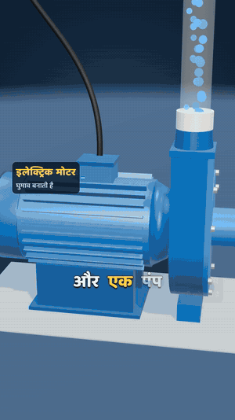
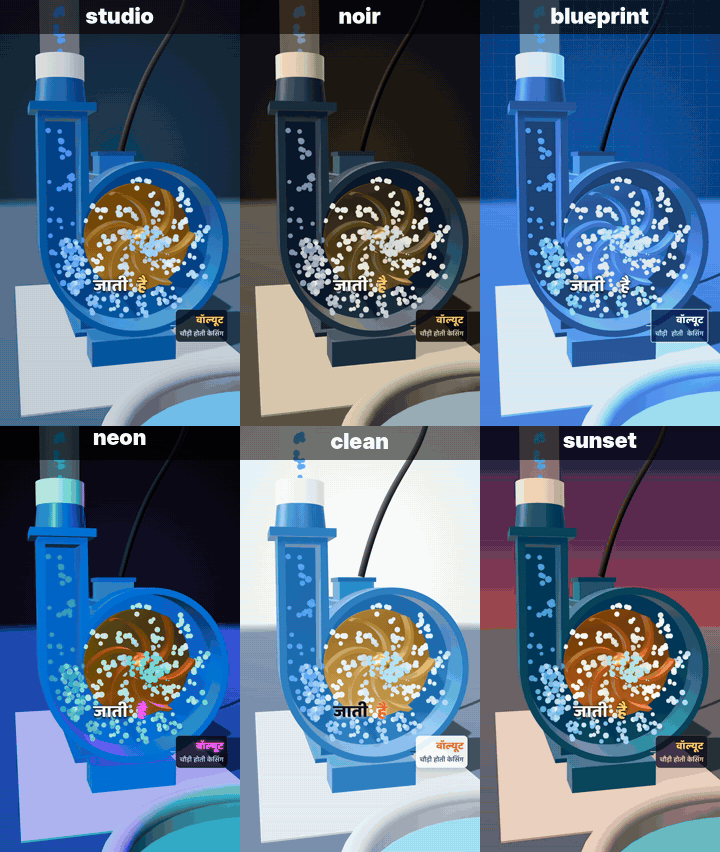
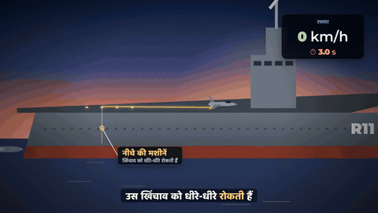

# Claude Animated Shorts: 2 video skills for Claude Code

Two skills that turn Claude Code into a YouTube animation studio for Hindi and English videos.
Everything is drawn with code and rendered on your own computer. There's no AI video generator,
no stock footage and no paid service. Bring a voice MP3 (ElevenLabs or any other) and you get a finished video.

| Skill | Type this in Claude Code | You get | Looks |
|---|---|---|---|
| **3D machine explainer** | `/explainer-3d` | 50-60 s vertical Short (1080×1920, 60 fps) | 6 themes |
| **Documentary** | `/documentary` | 3-6 min YouTube film (1920×1080, 60 fps) + thumbnails + YouTube text | 5 × 2D themes + 3D realistic |

---

## 1. `/explainer-3d`: 3D "how it works" Short (motor-video style)



*Water motor, bike engine and submersible pump, all made with this skill.*

### 6 themes: same machine, one word changes the whole look


| Theme | Best for |
|---|---|
| `studio` | Default. Any machine (blue studio, yellow captions) |
| `noir` | Premium: cars, engines, watches (black + gold) |
| `blueprint` | Engineering / design: blueprint-blue grid, mono labels |
| `neon` | Tech, gadgets, gaming (black + magenta/cyan glow) |
| `clean` | Home appliances: white Apple-style studio |
| `sunset` | Emotional / story hooks: warm dusk gradient |

**How to use**
```
/explainer-3d  Mixer grinder kaise kaam karta hai, Hindi Short, neon theme
```
1. Claude writes the facts and the script, line by line with the picture for each line, and gives you the Hindi script with ElevenLabs tags.
2. You send the MP3, or ask for the free offline English voice.
3. Claude builds the machine in 3D from code, times every move to the voice, checks stills, then renders.

**What you get:** `short.mp4` (1080×1920, 60 fps, about 55 s, word-by-word captions, music and sound effects),
a Shorts title, description, tags, and thumbnail ideas.

---

## 2. `/documentary`: premium documentary



*INS Vikrant, Chenab Bridge, Rail ka Jadu and Chandrayaan-3, all made with this skill (2D mode).*

### NEW: 3D realistic mode


A physical sky and sun, a reflective ocean, shadows, bloom and a cinematic film grade (letterbox, grain, warm/teal).
The subject is built from code with real proportions; this demo is a 262 m aircraft carrier at sunset.
Best for ships, aircraft, rockets, bridges and buildings: anything that should feel real.

### 5 themes for 2D mode: the same film, a different mood


| Theme | Best for |
|---|---|
| `night` | Default. Defence, engineering, space (navy + gold) |
| `cinematic` | Story-led and emotional films (film grade, letterbox, serif titles) |
| `archive` | History and freedom struggle (sepia film, grain, flicker) |
| `neon` | Tech, AI, space, gaming (black + glow) |
| `news` | "Breaking" explainers, current events (red caption box) |

**How to use**
```
/documentary  INS Vikrant, 3D realistic
/documentary  1857 ki kranti, archive theme
```
1. Claude picks the angle, researches the facts and writes a 4-5 minute chapter script with ElevenLabs v3 emotion tags.
2. You make the MP3 in ElevenLabs (Eleven v3) and send it.
3. Claude times every word, animates every chapter, adds the soundtrack and renders.
4. Want English too? Say "English version bhi banao": same animation, English text and captions, separate video.

**What you get:** `film.mp4` (1920×1080, 60 fps, about 200 MB for 5 minutes), `.srt` subtitles, 3 thumbnails, and
`youtube.txt` with titles, description, chapters, tags and hashtags.

---

## Install (once)

```bash
git clone https://github.com/VCbro/claude-animated-shorts.git
mkdir -p ~/.claude/skills
cp -r claude-animated-shorts/.claude/skills/* ~/.claude/skills/
```
Then restart Claude Code and type `/explainer-3d` or `/documentary`.

**You also need:** Node.js 18+, Python 3.10+ and ffmpeg. Each skill tells Claude the exact `npm install` and
`pip install` commands, and Claude runs them in your new project the first time.
A GPU isn't needed. Videos render with software WebGL; a 5-minute 2D documentary takes about 30-60 minutes on 4 CPU cores,
while 3D realistic mode is slower (render at 30 fps, or leave it overnight).

## What's inside

```
.claude/skills/
  explainer-3d/   SKILL.md
                  template/    the full water-motor project + web/themes.js (6 themes)
                  examples/    bike engine and submersible pump (scene + timeline)
                  reference/   three.js geometry, lighting, shaders, exploded views, frame capture
  documentary/    SKILL.md
                  template/    2D engine + web/themes.js (5 themes), Whisper timing, alignment, capture, sound, thumbnails
                  template-3d/ 3D realistic engine (sky, ocean, shadows, bloom, film grade) + carrier example film
                  examples/    the complete INS Vikrant film: script, anchors, film.js, audio
assets/           demo GIFs
```

## Tips
- **Voice:** ElevenLabs **Eleven v3** with a deep narrator voice works best. Emotion tags in `[ ]` aren't spoken.
- **Hindi + English:** upload as two separate videos and set "Video language" for each. YouTube's multi-language
  audio feature isn't available on most channels.
- **File size:** 1080p 60 fps keeps a 5-minute film around 200 MB, small enough to send in chat. 4K files are over 500 MB.
- **Not sure about the theme?** Ask Claude to render 3 stills in different themes, then pick one.

## License
MIT (see `LICENSE`).
